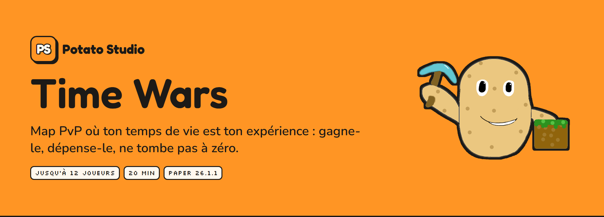
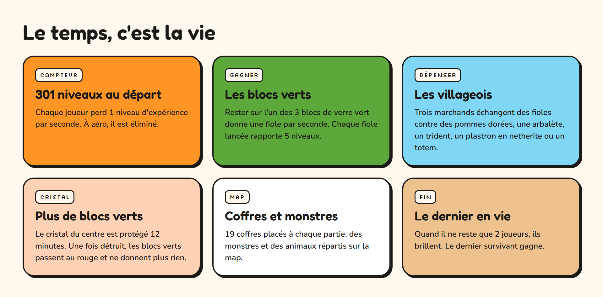
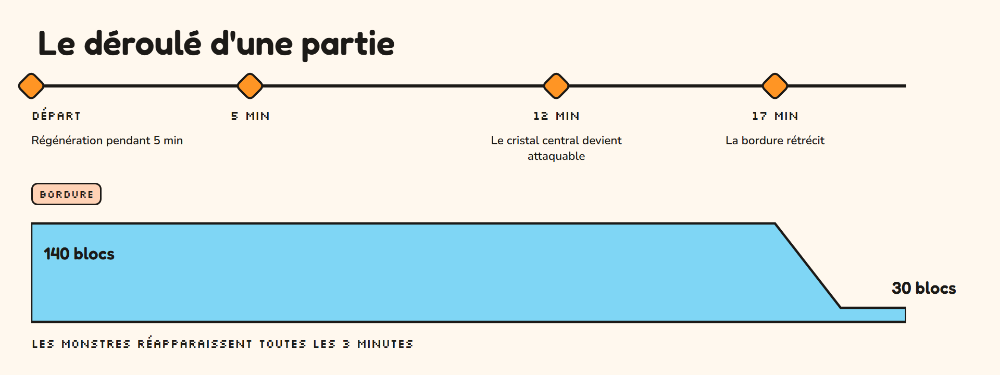

  

  

# Time Wars

Map PvP où le temps de vie de chaque joueur est son expérience, signée Potato Studio.

## Testé sur

| | |
| --- | --- |
| Serveur | Paper 26.1.1 |
| Datapack | Time Wars features, inclus dans le monde |
| Plugins utilisés | Aucun |

## Contenu

| Dossier | Contenu |
| --- | --- |
| `map-time-wars/` | Le monde, datapack inclus |
| `doc/` | Visuels de ce README |

La release contient `time-wars-map-v1.0.0.zip`.

## La partie

Jusqu'à 12 joueurs, environ 20 minutes.

- Chaque joueur commence avec 301 niveaux d'expérience et en perd 1 par seconde. À zéro, il est éliminé et passe spectateur.
- Rester sur l'un des 3 blocs de verre vert donne une fiole d'expérience par seconde. Une fiole lancée rapporte 5 niveaux.
- 3 villageois échangent des fioles contre une hache en fer, des pommes dorées, une arbalète, un trident, des perles de l'Ender, un plastron en netherite ou un totem d'immortalité.
- Le cristal du centre est protégé pendant 12 minutes. Une fois détruit, les blocs verts passent au rouge et ne donnent plus de fioles.
- 19 coffres sont placés à chaque partie. Des monstres et des animaux sont répartis sur la map.
- Équipement de départ : un bâton Recul II et un bouclier.
- Quand il ne reste que 2 joueurs, ils brillent. Le dernier survivant gagne.

### Déroulé

- Compte à rebours de 5 secondes au lancement
- Régénération pendant les 5 premières minutes
- Cristal attaquable à 12 minutes
- Bordure de 140 blocs, qui rétrécit jusqu'à 30 blocs à partir de 17 minutes
- Les monstres réapparaissent toutes les 3 minutes

## Installation

1. Télécharger `time-wars-map-v1.0.0.zip` depuis la [dernière release](../../releases/latest).
2. Dézipper le monde à la racine du serveur et indiquer `level-name=time-wars` dans `server.properties`.
3. Démarrer le serveur. Le datapack est déjà dans le dossier `datapacks/` du monde.

Une fois tous les joueurs connectés, `/function main:load` lance une partie. Le datapack la lance aussi à chaque `/reload`.

## Crédits

Time Wars est une création de Potato Studio.

## Règles de réutilisation

Réutilise, crédite, ne revends pas. Le détail est dans [LICENSE.md](LICENSE.md) : jouer, filmer, streamer et modifier sont autorisés avec le crédit « Map par Potato Studio » ; la revente et l'usage du nom, du logo et de la mascotte ne le sont pas.

NOT AN OFFICIAL MINECRAFT MAP. NOT APPROVED BY OR ASSOCIATED WITH MOJANG OR MICROSOFT.
